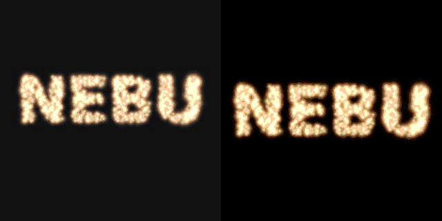

# RAYMOSAIC Mission 08 — release report

Canonical application commit: `02e8c357cca9839d4505f68e9424f47cdc079988`.

Validated on 17 October 2026. Application baseline: `da8c06e`; website baseline: `b555fa3`.

## Export correction

The old dialog continued offering a completed full-scene file after “Projection only” was selected. This stale-download failure was reproduced in both Chromium and Firefox using an untouched Mission 07 checkout. The existing projection function already omitted apparatus geometry; switching the checkbox alone did not replace the previously encoded file.

Changing any export option now revokes that file and clears preview/download/share actions. Settings are locked during encoding, restored on completion/cancellation/failure, and closing clears the completed result. The quick gift action selects projection mode explicitly.

`export-renderer.js` provides an explicit boundary between projection and apparatus rendering. Projection mode draws only forward-calculated light sprites on exact black, without entering the full-scene renderer. Full-scene mode retains its separate perspective camera, lamp, mirrors and wall. Projection GIF encoding disables ordered dithering.

One fixed transform frames the union of actual forward center-ray intersections across every completed message scene. The old arbitrary magnification cap is removed. Glow footprints are constrained to the reserved margins; signature space is optional. During reorientation, transient rays may move outside the completed artwork's frame; framing stays fixed instead of chasing them.

At the same fully aligned frame in a 320 × 320, 666-mirror NEBU export, independently measured luminous width increased from **266 to 284 pixels in Chromium (+6.8%)** and **265 to 284 in Firefox (+7.2%)**. The right-hand image also removes the old background raster. This compares genuine projection exports; the stale full-scene download was a separate, more conspicuous failure. These figures describe this sample, not every possible drawing.

## Interface and editorial changes

- English/German export actions remain localized after completion, setting changes, cancellation and errors. Preparing/encoding status, frame counts, sequence advice, native share text, preview alt text and close-button accessibility labels are localized.
- Both existing blog permalinks were updated with the optical calculation, drawing/text orientation, complete messages, all three modes, local export/privacy, projection-only behavior and model limits. Titles, descriptions, JSON-LD, catalog entries, feeds and image sitemap references agree.
- README reorganized around the live demos, actual simulation, official modes, exports, privacy, development, tests and limits. Six self-contained flat badges accompany the genuine linked GitHub Actions status badge. The MIT badge is backed by the actual LICENSE.
- Examples include a new genuine 512 × 512, 36-frame LOVE projection GIF, a current 1600 × 1000 interface screenshot encoded as WebP, and refreshed NEBU projection/full-scene exports.
- Website sync includes the new export renderer and example; the German entry point continues loading the shared application core.

## Actual validation

| Check | Result |
| --- | --- |
| Node optics, project, sequence and export regressions | **28/28 passed** |
| Chromium 141.0.7390.37 and Firefox 142.0.1 | Complete Mission 08 browser suite passed in both |
| New export matrix | **44 downloaded GIFs independently decoded with Pillow**, including both modes × 3 formats × 3 mirror counts, signature pairs and complete sequences |
| Independent output checks | Every frame decoded, looping/timing/change verified; exact-black projection backgrounds, no cool apparatus pixels, large centered motifs in aligned frames, removable signatures and valid 1600 × 900 PNGs |
| Existing browser suites | Smoke + Missions 05, 06 and 07 passed in both browsers, including drawing orientation, project/link restoration, public sharing, labels, cancellation and simulated mobile sizes |
| Existing media decoders | All passed; both 17-scene long-message exports retain **304 frames** |
| Website integration | EN and DE lab routes passed in **both** Chromium and Firefox: actual GIF worker, localized frame counts, creation links, public links and project persistence |
| Website/feeds/sitemap/localization suite | **33/33 passed** |
| SEO audit | **0 validation errors**; 1047 unique sitemap URLs, no missing indexable pages, canonical/hreflang mismatches or broken crawlable links |
| Canonical application sync | Application source, renderer, styles, license and bundled examples compared byte-for-byte after sync |

The local test container required Firefox sandbox accommodations in its test launcher. These were external to the repositories; application and CI browser defaults were not changed. No physical Android/iOS or native messenger handoff verification is claimed. The workflow now includes Mission 08 regressions, independent decoding and both-browser prefixed website integration.

## Integration boundary

Only GitHub integration is authorized. No Worldnode deployment, public release, social announcement, repository visibility change or branch deletion is performed.

GitHub reported `dennishilk/raymosaic` as **already public** at the start of this mission, contrary to the supplied private-repository assumption. Its visibility was left unchanged as explicitly instructed. Public articles link to the live lab and museum, without relying on repository access.
