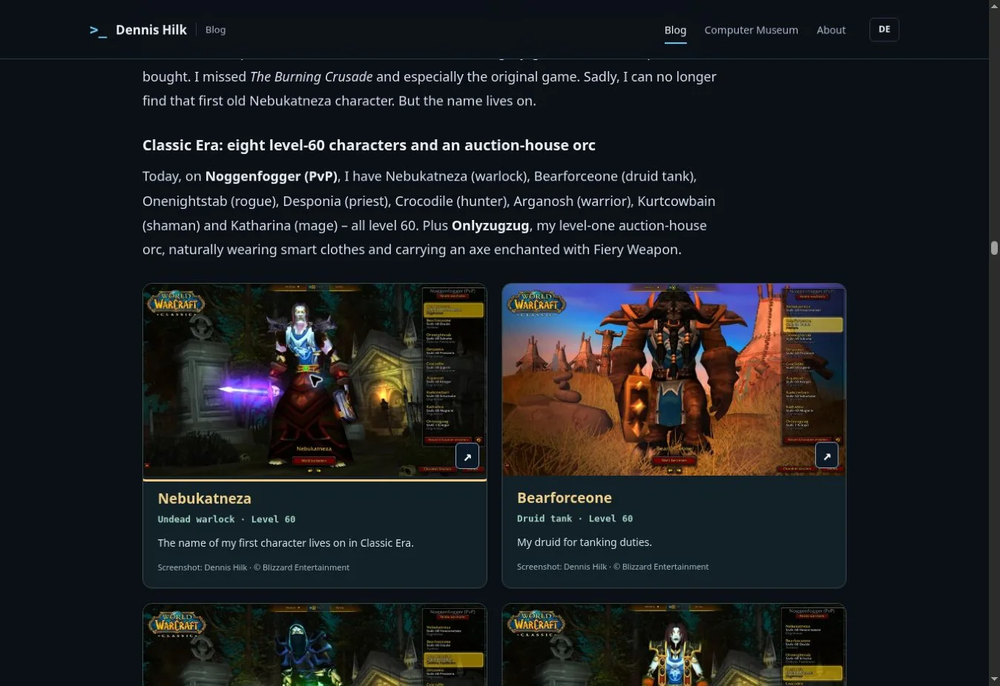
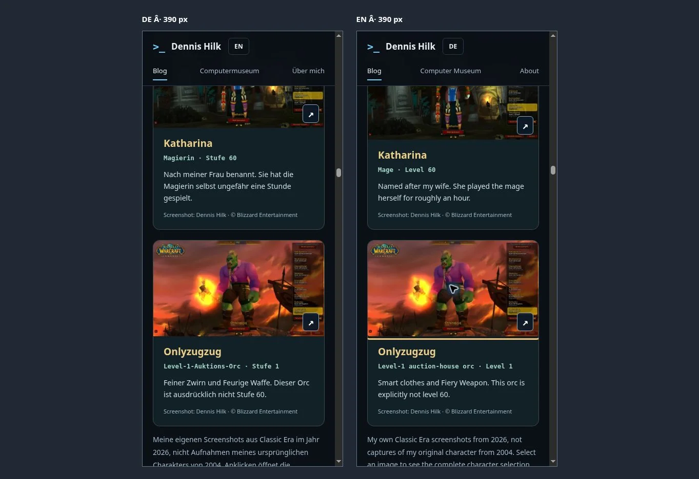

# Gaming Journey verification

## Wikimedia image and search metadata follow-up, 7 November 2026

The archive includes imagery for 79 of the same 99 games. This pass adds 14 game logos or wordmarks and three clearly labelled reference photographs. The Konami arcade board is a reference for the NES title, and the other two photographs depict the designers of Beneath a Steel Sky and Leisure Suit Larry 6. The remaining 20 entries have further reference links at the end of the article. English Wikipedia files with only a non-free use rationale are linked through their articles. Each locally displayed image has a file-level provenance record.

The German and English articles have revised search titles and summaries, contextual section headings, localized internal links to the related Longbow and Arch/Linux articles, structured hero image metadata, and matching Open Graph image dimensions and alt text. The RSS and sitemap generators include the update. The original published dates, canonical URLs and language alternates are preserved.

## First image archive update, 7 November 2026

Both language editions retain all 99 entries in the original order. 62 entries have imagery: 30 game screenshots, one cover, one official illustration, 25 title logos and five labelled reference images. The other 37 entries appear as text with external image references in the sources section. Their artwork remains an open item and the article lists every title. The platform placeholders were removed.

Six hardware generation figures now use genuine reference photographs, bringing the total to 18 historical hardware photographs. Captions identify differences between the referenced hardware and the author's own components. All nine supplied WoW character screenshots and the expandable Cthulhu hero are present. The paperclip tribute has eyes and a short, user-triggered movement that respects reduced motion.

Original source and licence links are grouped at the bottom in both languages. Captions link to the relevant credit where appropriate. The unified manifest distinguishes screenshots, covers, artwork, logos and references. New WebP images were decoded and their recorded dimensions checked.

Validation: 78 focused website tests pass. Both RSS feeds pass their generation check, and the sitemap and SEO audits pass with zero errors. The update advances the article modification dates, the two blog sitemap entries and both feed build dates to 7 November 2026.

## First illustrated edition, 6 November 2026

The sections below record the previous edition as it was delivered on 6 November.

Repository: `dennishilk/dennishilk.github.io`. The backend/collector repository and Worldnode were not touched.

## Scope and editorial result

The existing German and English URLs remain unchanged:

- `/de/blog/meine-spiele-von-damals-bis-heute/`
- `/blog/my-gaming-journey-1984-2026/`

Both versions preserve all 99 original archive entries in their original order. Personal narration remains first person; shared experiences with Sven/family retain appropriate plurals. The revisions include confirmed Weezer/Buddy Holly and the earworm; meeting Sven at the parents’ silver wedding anniversary; Athlon clock/FSB/multiplier/pencil/silver-paint explanation without an invented stepping or board; exact original Quake 1.01 impulse 9 behavior; the corrected Kazaa execution, roughly one-second command prompt, precautionary data backup and Windows reinstall (Sub7/worm/tool only a suspicion); and the VHS-C movie with its real title and digitization intention. No footage was published.

ISA/PCI/AGP, ViRGE/Voodoo pass-through, software rendering/GLQuake, Celeron 300A, crossover Ethernet, modem/DSL, IDE/SATA, removable drive caddies, historical NVIDIA driver/module friction and Arch/dwm are explained alongside the memories. Source references distinguish documented technical facts from personal recollection. Existing story passages including Guybrush/F10, José/Paraguay, Pringles/malt beer, Onyxia/Quel’Serrar, Dungeon Set 2, full Tier 1/hunter weapons and the 7 a.m. Silithus kindness story are retained.

## Media coverage

| Item | Result |
| --- | --- |
| Original game archive | 99 cards per language |
| Actual game image coverage | 6 entries: C&C Tiberian Dawn, Red Alert, Red Alert 2, SimCity 2000, Baldur’s Gate 3, WoW/Classic Era |
| Labelled fallback cards | 93, individually listed below and in both articles |
| Supplied WoW screenshots | 9/9 matched by character name; eight level 60, Onlyzugzug level 1 |
| Historical hardware photographs | 12, each labelled as a reference photograph |
| Additional hardware schematics | 6 labelled generation cards |
| Original technical diagrams | 3 concepts, separately localized: Athlon L1, Voodoo VGA path, Ethernet crossover |
| Paperclip cameo | Original generic SVG, not Microsoft artwork; user-requested 2.6-second CSS animation, reduced-motion override, no sound |

World of Warcraft screenshot rights are separate from the author’s capture rights. EA and Larian/Wizards imagery uses documented fan-content permission, not Creative Commons. Commons reference photographs link their exact file source, creator and selected licence. Share-alike derivative conditions are retained. Author photographs, approved existing desktop captures and original SVG illustrations are identified separately. All published media are local. Full images load only on selection; links still open originals without JavaScript.

The newly supplied Wings/Steam library capture and two new desktop/terminal captures were not republished because underlying game/library/wallpaper artwork clearance was not established. The existing site-approved Cthulhu desktop remains in use and is clickable. This omission does not affect the nine supplied character images.

Machine-readable records: `assets/blog/gaming-journey/image-sources.json`, with the per-source hardware/game/personal manifests alongside it. The unified manifest names every published article image or thumbnail, source, creator, permission/licence, modification and section, and records excluded supplied files.

## Validation

- 78 automated tests passed: 13 focused memoir checks plus 65 existing sitemap, RSS, localization and Linux news checks.
- `node scripts/generate-blog-rss.mjs --check`: EN/DE feeds match all 56 published articles per locale.
- `node scripts/audit-seo.mjs` and `npm run test:seo`: zero validation errors.
- `node scripts/sync-seo.mjs` and the sitemap-only mode were run. Unrelated metadata normalization changes were discarded. Only the two memoir entries changed in the blog sitemap; all unrelated entries and their historical lastmod values are byte-equivalent at XML-entry level. Other sitemap files remain unchanged.
- Original title order compared directly with the pre-change pages; all 99 entries retained. No new article routes or blog-index cards were created; existing category counts and structured ItemLists remain intact.
- Local asset paths, image captions/alt/dimensions/provenance, internal links, fragment navigation, one H1, BlogPosting/BreadcrumbList and reciprocal canonical/hreflang/x-default checked.
- Every new WebP decoded during asset preparation; proportions and thumbnail sizes checked. Below-the-fold article images are lazy loaded, hero has eager/high priority and its real aspect ratio.
- Browser checks in Chromium: DE/EN desktop; side-by-side 390px frames (375px content viewport with scrollbar), no horizontal overflow; hero enlargement; all 18 character link/locale combinations; Escape close and focus restoration; keyboard filter activation; combined title/platform/image filters; zero-result message; reset to 99; paperclip button. No page-origin console errors or visible broken images observed. Native dialog semantics provide keyboard focus confinement.
- Static no-JavaScript behavior is preserved through visible HTML cards and ordinary image links. No measured Lighthouse/Core Web Vitals score is claimed; image dimensions, lazy loading and transfer sizes are the performance evidence.

Browser evidence:

## Search and SEO rationale

Public DE/EN search checks used variants around Athlon Bleistift-Trick, Celeron 300A, retro PC gaming memories, LAN, Windows 95/Buddy Holly and 3dfx/GLQuake. These support explanatory headings and natural long-tail terminology, not claims about keyword volumes or rankings. No Search Console query-volume data or ranking guarantees are invented. Descriptions emphasize the personal illustrated memoir; original page publication and modification date are both 2026-11-06. Canonical URLs, reciprocal language routes, OG locales and genuine featured image are preserved. No thin game detail pages, tracking or third-party media requests were added.

## Entries without cleared game artwork

Each uses an original, explicitly labelled platform illustration plus a title-specific external reference search. This is the current clearance inventory, not a claim that no permission could ever be obtained.

- Super Mario Bros.
- The Legend of Zelda
- Castlevania
- DuckTales
- Teenage Mutant Ninja Turtles
- Tetris
- Super Mario Land
- The Secret of Monkey Island
- Monkey Island 2: LeChuck's Revenge
- Turrican II
- Another World
- Lotus Turbo Challenge
- Eye of the Beholder I & II
- Beneath a Steel Sky
- Maniac Mansion
- Simon the Sorcerer
- F/A-18 Interceptor
- Wings (Cinemaware)
- Ambermoon
- Leisure Suit Larry (Original)
- Archer Maclean's Pool
- Super Mario (SNES)
- The Legend of Zelda: A Link to the Past
- Donkey Kong Country
- Street Fighter
- Mortal Kombat
- Super Mario Kart
- Super Castlevania IV
- Super Turrican
- The Ren & Stimpy Show: Veediots!
- Need for Speed (PlayStation)
- Super Mario 64
- GoldenEye 007
- Prince of Persia
- LOOM
- Zak McKracken and the Alien Mindbenders
- SimCity
- Sid Meier's Pirates!
- Centurion: Defender of Rome
- Microsoft Flight Simulator 3.0
- Test Drive
- International Karate+ (IK+)
- Rick Dangerous
- Wings of Fury
- Duke Nukem (1991)
- Duke Nukem II
- LHX Attack Chopper
- Paperboy
- Wolfenstein 3D
- Rise of the Triad
- Hexen: Beyond Heretic
- Raptor: Call of the Shadows
- Primal Rage
- Day of the Tentacle
- Sam & Max Hit the Road
- Leisure Suit Larry 6
- Baphomets Fluch / Broken Sword
- Mad TV
- Quake
- Quake II
- Duke Nukem 3D
- Turok: Dinosaur Hunter
- GLQuake
- Unreal Tournament (1999)
- Counter-Strike
- Quake III Arena
- Max Payne
- Half-Life 2
- Crysis
- Jane's AH-64D Longbow
- Aces of the Deep
- Silent Hunter / Silent Hunter III
- Battlefield 3 / 4
- Battlefield 1
- Diablo III
- South Park: The Stick of Truth
- Grand Theft Auto V
- Far Cry 3
- Farming Simulator 15
- Kerbal Space Program
- The Vanishing of Ethan Carter
- Red Dead Redemption 2
- The Witcher 3: Blood and Wine
- Kingdom Come: Deliverance
- DOOM Eternal
- Assetto Corsa Competizione
- Genshin Impact
- Kingdom Come: Deliverance II
- Starfield
- Alan Wake 2
- Microsoft Flight Simulator 2024
- War Thunder
- The Secret of Monkey Island: Special Edition

## Deployment

GitHub delivery only. Dennis pulls the merged `main` on Worldnode separately. Never force-pull or hard-reset a divergent publication branch.
